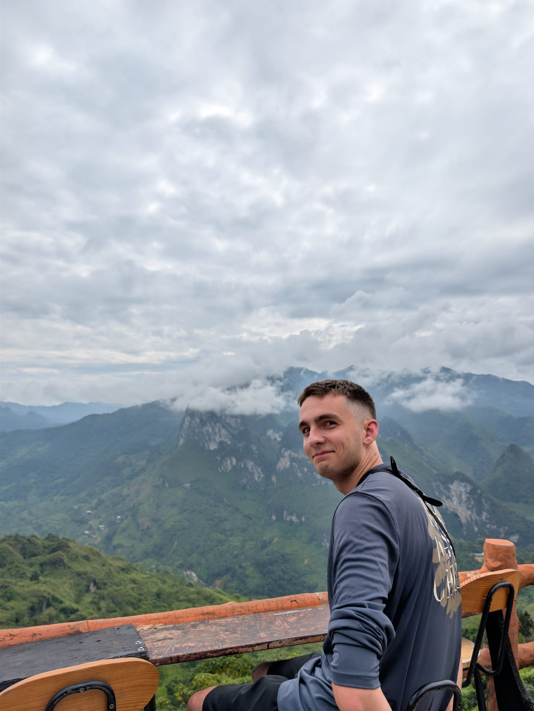

# Introduction
Hi! I'm Ezio, a Software Engineering student in the Software Maintenance and Evolution course.

I expect to learn how real-world software is maintained, improved and kept reliable over time, including working with legacy code.

- **Course expectations**: To gain hands-on experience in maintaining and evolving software and collaborating with Git and GitHub.

## Technologies I Love
I'm passionate about the web and modern technologies:

- **Web development**: building fast, modern and user-friendly web applications
- **React**: component-based UI development
- **Next.js**: full-stack React framework (SSR, routing, API routes)
- **Modern tooling**: always exploring up-to-date tools and best practices

